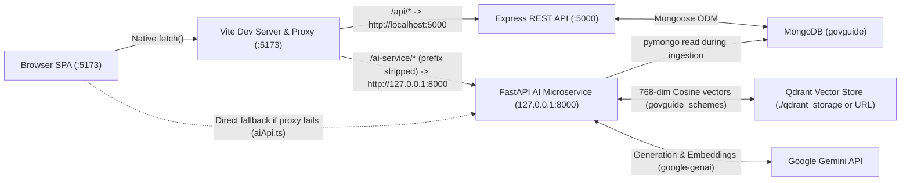
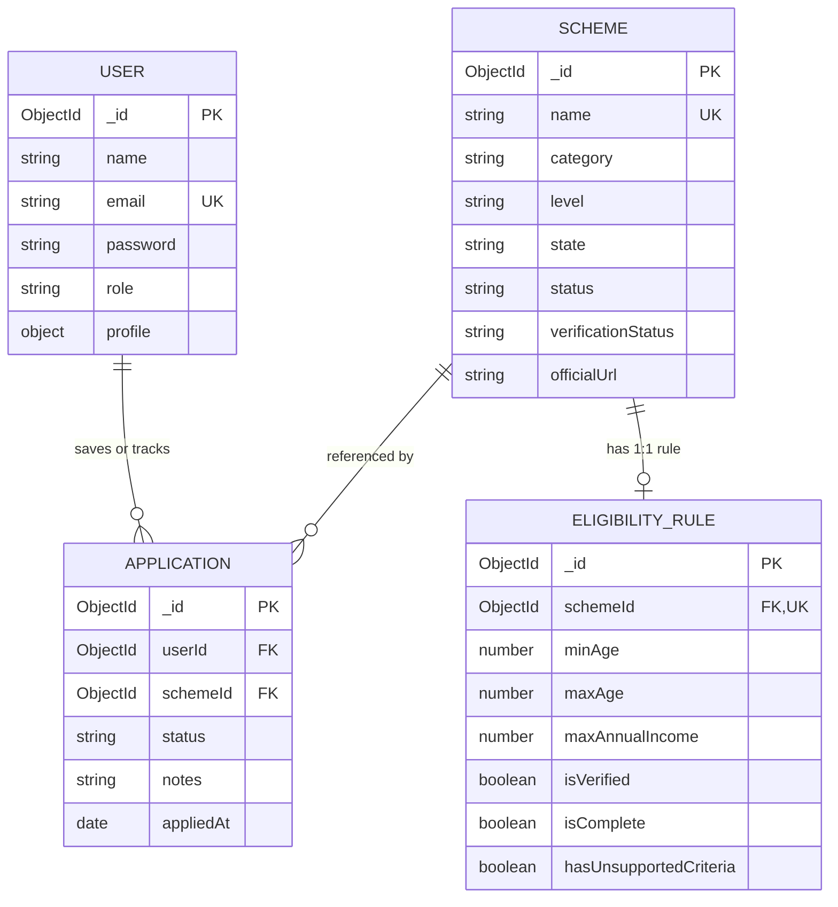
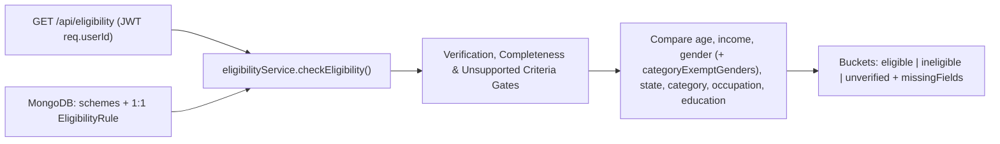

# GovGuide Bihar — Complete System Architecture & Technical Reference

This document maps the implemented architecture, schemas, API endpoints, AI pipelines, frontend state management, end-to-end workflows, and audited gaps across `frontend`, `backend`, `ai-services`, and `data` in the **GovGuide Bihar** workspace (`c:\Users\kisho\Desktop\govguide`).

---

## 1. System Overview & Tech Stack

GovGuide Bihar is organized as three decoupled services plus curated dataset scripts and files (with **no root `package.json`**):

1. **Frontend (`frontend/`)**: React 19 + TypeScript + Vite SPA serving the bilingual (`EN` / `हिंदी`) citizen portal on port `5173`.
2. **Backend (`backend/`)**: Node.js + Express 5 + TypeScript + Mongoose REST API on port `5000`, owning authentication, citizen profiles, scheme CRUD, deterministic eligibility evaluation, saved/application tracking, and scheme ingestion into MongoDB (`govguide`). **The Express backend makes zero HTTP calls to `ai-services`.**
3. **AI Services (`ai-services/`)**: Python + FastAPI microservice on `127.0.0.1:8000`, owning bilingual RAG chat (`Ask Saathi`), natural-language demographic extraction (`AI Quick Profile Fill`), and semantic chunking/vector indexing into Qdrant (`govguide_schemes`) directly from MongoDB.

### 1.1 Exact Frameworks, Libraries, Models & Runtime Versions

| Layer | Runtime / Core | Key Dependencies (from manifests & configs) | Ports / Storage |
| :--- | :--- | :--- | :--- |
| **Frontend** (`frontend/package.json`) | React `^19.2.8`, React DOM `^19.2.8`, TypeScript `~6.0.2`, Vite `^8.3.0`, `@vitejs/plugin-react ^6.1.1` | `react-router-dom ^7.18.4`, `tailwindcss ^3.4.19`, `@radix-ui/react-dialog ^1.1.23`, `@radix-ui/react-slot ^1.3.3`, `class-variance-authority ^0.7.1`, `clsx ^2.1.1`, `tailwind-merge ^3.7.0`, `i18next ^26.4.4`, `react-i18next ^17.0.16`, `framer-motion ^13.4.1`, `lucide-react ^1.47.0` | Dev server `:5173` (native `fetch()`, no `axios`) |
| **Backend** (`backend/package.json`) | Node.js, Express `^5.2.1`, TypeScript `^5.9.2`, `ts-node-dev ^2.0.0` | `mongoose ^9.10.1`, `jsonwebtoken ^9.0.3`, `bcryptjs ^3.0.3`, `cors ^2.8.6`, `dotenv ^17.4.2` | API `:5000` -> `mongodb://127.0.0.1:27017/govguide` |
| **AI Services** (`ai-services/requirements.txt`) | Python, FastAPI `>=0.115.0`, Uvicorn `[standard]>=0.32.0`, Pydantic `>=2.9.0`, `pydantic-settings >=2.5.0`, `python-dotenv >=1.0.1` | `google-genai >=1.0.0` (active), `google-generativeai >=0.8.0` (listed, unused legacy SDK), `qdrant-client >=1.12.0`, `pymongo >=4.10.0`, `httpx >=0.28.0` | API `127.0.0.1:8000` -> Qdrant (`./qdrant_storage` local SQLite when `QDRANT_URL` is empty) + MongoDB `govguide` |
| **AI Models** (`ai-services/.env` & `app/core/`) | Google Gemini API (`google.genai.Client`) | Active `GEMINI_MODEL=gemini-3.5-flash` (fallback chain includes `gemini-3.5-flash-lite`, `gemini-flash-latest`, `gemini-2.5-flash`); active `EMBEDDING_MODEL=gemini-embedding-001` (768-dim Cosine) | Collection `govguide_schemes` |

### 1.2 Inter-Service Communication Topology



- **Frontend -> Backend (`vite.config.ts`)**: All `/api/*` requests proxy to `http://localhost:5000`. Auth uses `Authorization: Bearer <token>` from `localStorage` (no HttpOnly cookies).
- **Frontend -> AI Services (`vite.config.ts` & `frontend/src/services/aiApi.ts`)**: `/ai-service/*` rewrites out the `/ai-service` prefix and proxies to `http://127.0.0.1:8000` (e.g., `/ai-service/api/v1/chat` -> `http://127.0.0.1:8000/api/v1/chat`). `aiApi.ts` also includes a client-side fallback straight to `http://127.0.0.1:8000/api/v1/*`.
- **Shared Database Read**: Both `backend` (`mongoose`) and `ai-services` (`pymongo`) point to `mongodb://127.0.0.1:27017/govguide`.

---

## 2. Complete Directory Structure

All 187 tracked source/config/data files in the repository (excluding `node_modules`, `.venv`, `venv`, `.git`, `dist`, `build`, `__pycache__`, `.pytest_cache`, and `qdrant_storage`), plus this architecture document:

```text
govguide/
├── .gitignore                                         # Root Git ignore rules
├── CURRENT_FUNCTIONALITIES.md                         # Project documentation of implemented features
├── FLOW.MD                                            # Project documentation of user and system flows
├── PROJECT_ARCHITECTURE.md                            # This comprehensive system architecture document
├── PROJECT_STATUS.md                                  # Project status and phase tracking notes
│
├── data/
│   ├── bihar/
│   │   ├── all_bihar_schemes.json                     # Curated Bihar + Central dataset (32 scheme records)
│   │   └── build_bihar_dataset.js                     # Node builder script generating all_bihar_schemes.json
│   ├── pilot/
│   │   └── verified_pilot_schemes.json                # Curated verified pilot scheme dataset (10 scheme records)
│   └── samples/
│       ├── sample_schemes.csv                         # Sample CSV ingestion fixture (4 lines: header + 3 rows)
│       └── sample_schemes.json                        # Sample JSON ingestion fixture (4 scheme records)
│
├── ai-services/
│   ├── .env                                           # Local AI service environment variables (ports, model names, keys)
│   ├── .env.example                                   # Documented environment template for ai-services
│   ├── .gitignore                                     # Python/Qdrant/.env ignore rules
│   ├── README.md                                      # AI microservice setup and API usage documentation
│   ├── requirements.txt                               # Python dependencies for FastAPI, Gemini SDKs, Qdrant, PyMongo
│   ├── tests/
│   │   └── test_profile_normalizer.py                 # unittest suite (10 test cases) for profile normalization & /profile/extract
│   └── app/
│       ├── __init__.py                                # Package marker for app module
│       ├── config.py                                  # Pydantic BaseSettings loader (GEMINI, EMBEDDING, Qdrant, MongoDB, CORS)
│       ├── main.py                                    # FastAPI app entrypoint, CORS middleware, lifespan vector check, /health, /api/v1 router
│       ├── api/
│       │   ├── __init__.py                            # API package marker
│       │   └── v1/
│       │       ├── __init__.py                        # Registers chat, profile, and ingest routers under /v1
│       │       ├── chat.py                            # POST /api/v1/chat endpoint calling RAGGenerator
│       │       ├── ingest.py                          # POST /api/v1/ingest/schemes endpoint triggering Mongo -> Qdrant indexing
│       │       └── profile.py                         # POST /api/v1/profile/extract endpoint orchestrating PII masking, LLM & fallback extraction
│       ├── core/
│       │   ├── __init__.py                            # Core package marker & exports
│       │   ├── embeddings.py                          # EmbeddingService calling gemini-embedding-001 (768-dim) with SHA-256 fallback
│       │   ├── llm.py                                 # LLMService wrapping google.genai with FALLBACK_MODELS retry & JSON parsing
│       │   └── vector_store.py                        # VectorStoreService managing local SQLite or remote Qdrant + keyword indexes
│       ├── ingestion/
│       │   ├── __init__.py                            # Ingestion package marker
│       │   ├── chunker.py                             # Splits MongoDB scheme docs into up to 4 semantic text chunks
│       │   └── indexer.py                             # Reads govguide.schemes via pymongo, chunks, embeds, and batch-upserts to Qdrant
│       ├── rag/
│       │   ├── __init__.py                            # RAG package marker
│       │   ├── generator.py                           # RAGGenerator orchestrating retrieval, bilingual prompt build, refusal & citation checks
│       │   ├── prompt_templates.py                    # English/Hindi system prompts and citizen demographics formatter
│       │   └── retriever.py                           # Follow-up scheme alias enrichment, Qdrant search, and bilingual score boosting
│       ├── schemas/
│       │   ├── __init__.py                            # Schemas package marker
│       │   ├── chat.py                                # Pydantic models: CitizenProfileContext, ChatTurn, ChatRequest, SourceCitation, ChatResponse
│       │   ├── ingestion.py                           # Pydantic models: IngestionRequest, IngestionStatusResponse
│       │   └── profile.py                             # Pydantic models: ProfileExtractRequest, ExtractedProfileFields, ProfileExtractResponse
│       └── services/
│           ├── __init__.py                            # Services package marker
│           └── profile_normalizer.py                  # PII sanitizer, Gemini JSON prompt, EN/HI/Hinglish regex fallback, Bihar normalizer
│
├── backend/
│   ├── .env                                           # Local Express backend env config (PORT, MONGODB_URI, JWT_SECRET)
│   ├── .env.example                                   # Backend environment variable template
│   ├── .gitignore                                     # Node/.env ignore rules
│   ├── package.json                                   # Express 5, Mongoose 9, JWT, bcrypt, TypeScript manifest & scripts
│   ├── package-lock.json                              # Locked npm dependency tree for backend
│   ├── tsconfig.json                                  # TypeScript compiler configuration for Express backend
│   └── src/
│       ├── app.ts                                     # Express app setup: security headers, CORS, JSON parser (1mb), route mounts, error handler
│       ├── server.ts                                  # Server bootstrap connecting MongoDB and listening on configured PORT
│       ├── config/
│       │   ├── db.ts                                  # Mongoose MongoDB connection helper
│       │   ├── env.ts                                 # Loads and exports ENV config from dotenv
│       │   └── testDb.ts                              # Isolated test DB connection/teardown helper for backend verification scripts
│       ├── controllers/
│       │   ├── applicationController.ts               # Handlers for /api/saved and /api/applications CRUD & status normalization
│       │   ├── authController.ts                      # HTTP handlers for POST /api/auth/register and POST /api/auth/login
│       │   ├── eligibilityController.ts               # HTTP handler for GET /api/eligibility delegating to eligibilityService
│       │   ├── ingestionController.ts                 # Admin HTTP handlers for POST /api/admin/ingest/{json,csv}
│       │   ├── profileController.ts                   # HTTP handlers for GET /api/profile and PUT /api/profile
│       │   └── schemeController.ts                    # Handlers for scheme listing/detail (Bihar+Central filter) & admin CRUD
│       ├── middleware/
│       │   ├── adminMiddleware.ts                     # Verifies req.userId belongs to a user with role === "admin"
│       │   ├── authMiddleware.ts                      # Verifies Bearer JWT token and injects req.userId
│       │   ├── errorHandler.ts                        # Global Express error normalization middleware
│       │   └── rateLimiter.ts                         # In-memory IP rate limiter (used on auth routes: 30 req / 15 min)
│       ├── models/
│       │   ├── Application.ts                         # Mongoose schema linking userId + schemeId with saved/application lifecycle statuses
│       │   ├── EligibilityRule.ts                     # Mongoose 1:1 rule schema per scheme (age, income, gender, caste, state, occupation, etc.)
│       │   ├── Scheme.ts                              # Mongoose scheme schema with category enum, state hooks, Phase-1/B provenance metadata
│       │   └── User.ts                                # Mongoose citizen/admin account schema with embedded demographic profile subdocument
│       ├── pipeline/
│       │   ├── auditLogger.ts                         # Audit log recorder for scheme ingestion runs
│       │   ├── cli.ts                                 # CLI runner entrypoint for ingestion pipeline
│       │   ├── deduplicator.ts                        # Deduplication logic matching incoming scheme records against existing records
│       │   ├── index.ts                               # Barrel exports for ingestion pipeline modules
│       │   ├── types.ts                               # Shared TypeScript interfaces for ingestion payloads, validation & reports
│       │   ├── adapters/
│       │   │   ├── baseAdapter.ts                     # Abstract/base source adapter interface for ingestion
│       │   │   ├── csvAdapter.ts                      # Adapter converting CSV rows into raw ingestion scheme records
│       │   │   ├── csvParser.ts                       # Lightweight CSV text/file parser supporting quoted fields
│       │   │   └── jsonAdapter.ts                     # Adapter converting JSON arrays/objects into raw ingestion records
│       │   ├── normalizers/
│       │   │   ├── ruleNormalizer.ts                  # Normalizes raw eligibility attributes into EligibilityRule shapes
│       │   │   └── schemeNormalizer.ts                # Normalizes raw scheme records into Scheme document fields
│       │   ├── services/
│       │   │   ├── ingestionService.ts                # Orchestrates adapt -> normalize -> validate -> deduplicate -> persist & audit
│       │   │   └── verificationLifecycle.ts           # Manages scheme verification status transitions and rule linkage checks
│       │   └── validators/
│       │       └── ingestionValidator.ts              # Validates normalized schemes/rules before database persistence
│       ├── routes/
│       │   ├── applicationRoutes.ts                   # Mounts /api/applications routes & /api/applications/saved aliases
│       │   ├── authRoutes.ts                          # Mounts /api/auth/register & /api/auth/login with authRateLimiter
│       │   ├── eligibilityRoute.ts                    # Mounts GET /api/eligibility behind authMiddleware
│       │   ├── ingestionRoutes.ts                     # Mounts /api/admin/ingest/json & /csv behind auth + admin middleware
│       │   ├── profileRoutes.ts                       # Mounts GET/PUT /api/profile behind authMiddleware & validateProfileUpdate
│       │   ├── savedRoutes.ts                         # Mounts /api/saved routes behind authMiddleware
│       │   └── schemeRoutes.ts                        # Mounts /api/schemes GET (authMiddleware) and POST/PUT/DELETE (admin)
│       ├── scripts/
│       │   ├── seedPilotSchemes.ts                    # CLI seed script loading verified_pilot_schemes.json into MongoDB
│       │   ├── seedSchemes.ts                         # CLI seed script populating Bihar/Central schemes & rules
│       │   ├── testPhase1.ts                          # Phase-1 schema and backend behavior test script
│       │   ├── testPhase2.ts                          # Phase-2 backend verification test script
│       │   ├── testPhase4.ts                          # Phase-4 backend verification test script
│       │   ├── testPhaseA.ts                          # Phase-A verification test script
│       │   ├── testPhaseB.ts                          # Phase-B verification test script
│       │   ├── testPhaseB4.ts                         # Phase-B4 verification test script
│       │   ├── testPhaseB5.ts                         # Phase-B5 verification test script
│       │   ├── testPhaseBRemediation.ts               # Phase-B remediation verification script
│       │   ├── verifyEligibilityEngine.ts             # Standalone verification harness for checkEligibility logic
│       │   └── verifyEndpoints.ts                     # Endpoint verification script exercising backend HTTP routes
│       ├── services/
│       │   ├── authService.ts                         # Password hashing/verification, user registration, login & JWT generation
│       │   ├── eligibilityService.ts                  # Deterministic citizen-vs-EligibilityRule matching engine
│       │   └── schemeService.ts                       # Business logic for querying/modifying schemes
│       ├── types/
│       │   └── express.d.ts                           # Express Request augmentation adding req.userId
│       ├── utils/
│       │   └── generateToken.ts                       # JWT signing helper (expiresIn: "7d")
│       └── validators/
│           ├── authValidator.ts                       # Request validation for register (password >= 6) & login
│           ├── profileValidator.ts                    # Request validation for PUT /api/profile demographic fields
│           └── schemeValidator.ts                     # Request validation for admin scheme create/update payloads
│
└── frontend/
    ├── .gitignore                                     # Frontend Vite/build ignore rules
    ├── components.json                                # shadcn/ui component configuration
    ├── eslint.config.js                               # ESLint flat config for React + TypeScript
    ├── index.html                                     # Root HTML document mounting #root
    ├── package.json                                   # React 19, Router 7, Tailwind 3, i18next, Framer Motion manifest
    ├── package-lock.json                              # Locked npm dependency tree for frontend
    ├── postcss.config.js                              # PostCSS config enabling Tailwind CSS & Autoprefixer
    ├── README.md                                      # Frontend setup & Vite template documentation
    ├── tailwind.config.js                             # Tailwind CSS theme extensions & custom CSS variable color mappings
    ├── tsconfig.app.json                              # TypeScript config for application source files
    ├── tsconfig.json                                  # Root TypeScript project references config
    ├── tsconfig.node.json                             # TypeScript config for Vite build tooling files
    ├── vite.config.ts                                 # Vite dev server & /api, /ai-service reverse proxies
    ├── public/
    │   ├── favicon.svg                                # Browser tab SVG icon
    │   └── logo/
    │       ├── logo-full-dark.svg                     # Full GovGuide wordmark for dark backgrounds
    │       ├── logo-full-mono.svg                     # Monochrome GovGuide wordmark
    │       ├── logo-full.svg                          # Full GovGuide wordmark for light backgrounds
    │       └── logo-icon.svg                          # Compact GovGuide emblem SVG
    └── src/
        ├── App.tsx                                    # Root app providers + createBrowserRouter route definitions
        ├── index.css                                  # Tailwind directives & CSS theme design tokens
        ├── main.tsx                                   # React root mount + i18n initialization
        ├── components/
        │   ├── MainLayout.tsx                         # Shared page shell wrapping Navbar, Outlet, and floating Saathi widget
        │   ├── Navbar.tsx                             # Global header with nav links, Saved counter, language/theme toggles & profile menu
        │   ├── ProtectedRoute.tsx                     # Auth guard redirecting unauthenticated users to /login
        │   ├── SaveButton.tsx                         # Reusable bookmark toggle button calling SavedSchemesContext
        │   ├── ai/
        │   │   └── GovGuideSaathiWidget.tsx           # Floating bilingual AI chatbot drawer with prompt chips, history & citations
        │   ├── auth/
        │   │   └── AuthLayout.tsx                     # Split layout shell for LoginPage and RegisterPage
        │   ├── home/
        │   │   ├── BiharLifelineStrip.tsx             # Quick emergency/portal helpline strip for Bihar services
        │   │   ├── CategorySection.tsx                # Scheme category cards linking into filtered /schemes views
        │   │   ├── FeaturedSchemes.tsx                # Featured scheme grid fetching schemes via schemeApi
        │   │   ├── FinalCTA.tsx                       # Bottom call-to-action banner on HomePage
        │   │   ├── Footer.tsx                         # Site footer navigation and links
        │   │   ├── GovernmentLevelSection.tsx         # Central vs. Bihar State scheme breakdown section
        │   │   ├── HeroSection.tsx                    # Top landing banner with search input & live scheme count attempt
        │   │   ├── HowItWorks.tsx                     # 3-step citizen workflow explainer section on HomePage
        │   │   ├── OfficialSourceSection.tsx          # Verification & official government source trust band
        │   │   ├── SaatNischayBanner.tsx              # Bihar Saat Nischay highlight cards linking to /schemes?state=Bihar&q=...
        │   │   └── TrustSection.tsx                   # Trust metrics & portal assurances section
        │   ├── interactive/
        │   │   ├── InteractiveIconBackground.tsx      # Animated floating civic icon backdrop component
        │   │   └── iconData.ts                        # Static icon metadata and Tailwind color classes for background
        │   ├── profile/
        │   │   └── AiProfileAutoFillPanel.tsx         # Collapsible AI natural-language profile extractor UI on ProfilePage
        │   ├── theme/
        │   │   ├── LanguageSelector.tsx               # English / हिंदी i18next switcher control
        │   │   └── ThemeToggle.tsx                    # Light / Dark mode toggle button consuming ThemeContext
        │   └── ui/
        │       ├── badge.tsx                          # Reusable pill/badge UI primitive
        │       ├── button.tsx                         # Reusable variant button UI primitive
        │       ├── card.tsx                           # Reusable card container UI primitives
        │       ├── input.tsx                          # Reusable styled form input primitive
        │       └── sheet.tsx                          # Radix Dialog-based slide-over drawer primitive
        ├── context/
        │   ├── AiAssistantContext.tsx                 # Global chat drawer state, message history & aiApi.sendChatMessage calls
        │   ├── AuthContext.tsx                        # Global user/JWT auth state in localStorage, login/register/profile refresh
        │   ├── SavedSchemesContext.tsx                # Global saved scheme IDs state synchronized with savedSchemeApi
        │   └── ThemeContext.tsx                       # Global light/dark theme class toggle and persistence
        ├── i18n/
        │   ├── index.ts                               # i18next initialization binding English & Hindi translation resources
        │   └── locales/
        │       ├── en.json                            # English UI translation strings
        │       └── hi.json                            # Hindi UI translation strings
        ├── pages/
        │   ├── AboutPage.tsx                          # Mission, platform overview & institutional details page (/about)
        │   ├── ApplicationsPage.tsx                   # Saved & tracked application lifecycle dashboard (/applications)
        │   ├── CategoriesPage.tsx                     # Browsable catalog grouped by scheme categories (/categories)
        │   ├── EligiblePage.tsx                       # Personalized eligible / ineligible / unverified tabs (/eligible)
        │   ├── HomePage.tsx                           # Main landing page composing home section components (/)
        │   ├── HowItWorksPage.tsx                     # Standalone process explanation page (/how-it-works)
        │   ├── LoginPage.tsx                          # Email/password login + mocked mobile OTP & forgot-password UI (/login)
        │   ├── NotFoundPage.tsx                       # Fallback 404 page (*)
        │   ├── ProfilePage.tsx                        # Citizen Profile form, completion bar & AiProfileAutoFillPanel (/profile)
        │   ├── RegisterPage.tsx                       # Email registration + mocked mobile registration flow (/register)
        │   ├── SavedSchemesPage.tsx                   # Bookmarked schemes view (/saved)
        │   ├── SchemeDetailsPage.tsx                  # Asymmetric 2-column scheme detail page with eligibility strip & sticky actions
        │   └── SchemesPage.tsx                        # Searchable & filterable Bihar/Central schemes catalog (/schemes)
        ├── services/
        │   ├── aiApi.ts                               # Native fetch() client for /ai-service/api/v1/{chat,profile/extract} + :8000 fallback
        │   ├── applicationApi.ts                      # Native fetch() client for /api/applications CRUD & status updates
        │   ├── eligibilityApi.ts                      # Native fetch() client for GET /api/eligibility
        │   ├── profileApi.ts                          # Native fetch() client for GET/PUT /api/profile
        │   ├── savedSchemeApi.ts                      # Native fetch() client for /api/saved endpoints
        │   └── schemeApi.ts                           # Native fetch() client for GET /api/schemes & /api/schemes/:id
        ├── types/
        │   ├── application.ts                         # TypeScript interfaces for Application records & statuses
        │   ├── eligibility.ts                         # TypeScript interfaces for Eligibility API responses
        │   ├── savedScheme.ts                         # TypeScript interfaces for Saved scheme responses
        │   ├── scheme.ts                              # TypeScript interfaces for Scheme documents
        │   └── user.ts                                # TypeScript interfaces for User & CitizenProfile
        └── utils/
            ├── index.ts                               # Shared frontend utilities (e.g. class name helpers)
            └── schemeHighlights.ts                    # Extracts quick summary metadata & assistance highlights for SchemeDetailsPage
```

---

## 3. Database & Vector Schemas

### 3.1 MongoDB Collections (`govguide` via Mongoose)

#### 1. `User` (`backend/src/models/User.ts`)
Stores citizen and admin accounts alongside an embedded demographic profile subdocument (`_id: false`).

| Field | Type | Validation / Options | Notes |
| :--- | :--- | :--- | :--- |
| `name` | `String` | `required: true`, `trim: true` | Citizen full name |
| `email` | `String` | `required: true`, `unique: true`, `lowercase: true`, `trim: true` | Account login identifier |
| `password` | `String` | `required: true` | Bcrypt hash (salt rounds: `10`) |
| `role` | `String` | `enum: ["user", "admin"]`, `default: "user"` | Registration hardcodes `"user"` |
| `profile.age` | `Number` | `min: 0` | Citizen age in years |
| `profile.gender` | `String` | Optional | Matches `VALID_GENDERS` on frontend |
| `profile.state` | `String` | Optional | Primarily `"Bihar"` on frontend |
| `profile.district` | `String` | Optional | Bihar district name |
| `profile.annualIncome` | `Number` | `min: 0` | Annual household income in INR |
| `profile.occupation` | `String` | Optional | Occupation category |
| `profile.education` | `String` | Optional | Highest education level |
| `profile.category` | `String` | Optional | Social category (e.g. `General`, `OBC`, `EBC`, `BC`, `SC`, `ST`) |
| `createdAt`, `updatedAt` | `Date` | Automatic via `timestamps: true` | Audit timestamps |

#### 2. `Scheme` (`backend/src/models/Scheme.ts`)
Stores Central and Bihar State welfare schemes, operational metadata, and Phase-1/Phase-B verification provenance.

- **Index**: Compound index `{ category: 1, level: 1, state: 1 }`; unique index on `name`; `timestamps: true`.
- **`pre("validate")` Hook**: If `level === "state"`, enforces a non-empty `state`. Automatically populates `applicableStates = [state.trim()]` when `applicableStates` is empty.

| Field | Type | Validation / Rules | Default |
| :--- | :--- | :--- | :--- |
| `name` | `String` | `required`, `unique`, `trim`, length `3..200` | — |
| `description` | `String` | `required`, `trim`, `minlength: 10` | — |
| `category` | `String` | `required`, `trim`, `enum: VALID_CATEGORIES` (`Agriculture`, `Employment`, `Housing`, `Healthcare`, `Education`, `Women & Child`, `Financial Assistance`, `Social Welfare`, `Entrepreneurship`) | — |
| `level` | `String` | `required`, `enum: ["central", "state"]` | — |
| `state` | `String` | `trim`; required by `pre("validate")` when `level === "state"` | — |
| `benefits` | `[String]` | Array of benefit descriptions | `[]` |
| `eligibility` | `[String]` | Human-readable eligibility criteria | `[]` |
| `requiredDocuments` | `[String]` | Document checklist | `[]` |
| `applicationProcess` | `[String]` | Step-by-step application instructions | `[]` |
| `officialUrl` | `String` | `required`, `trim`, matches `/^https?:\/\/.+/i` | — |
| `source` | `String` | `required`, `trim` | — |
| `schemeType` | `String` | `enum: ["central-sector", "centrally-sponsored", "state", "ut"]` | `undefined` |
| `applicableStates` | `[String]` | Populated for state schemes by `pre("validate")` | `[]` |
| `sourcePlatform` | `String` | Optional origin portal name | `undefined` |
| `sourceId` | `String` | Optional source identifier | `undefined` |
| `verificationStatus` | `String` | `enum: ["verified", "unverified", "needs-review", "disputed"]` | `"unverified"` |
| `verifiedAt` | `Date` | Verification timestamp | `undefined` |
| `applicationUrl` | `String` | Optional HTTP/HTTPS portal URL | `undefined` |
| `status` | `String` | `enum: ["active", "discontinued", "under-review"]` | `"active"` |
| `hasDeterministicRule` | `Boolean` | Indicates whether an `EligibilityRule` covers the scheme | `undefined` |
| `aliases` | `[String]` | Alternate scheme names/acronyms | `[]` |
| `exclusions` | `[String]` | Explicit exclusion criteria | `[]` |
| `unresolvedQuestions` | `[String]` | Open provenance/clarification questions | `[]` |
| `officialDocUrl` | `String` | Optional HTTP/HTTPS reference document URL | `undefined` |
| `sourceDocumentTitle` | `String` | Official notification/guideline title | `undefined` |
| `verifiedBy` | `String` | Reviewer/verifier identifier | `undefined` |

#### 3. `EligibilityRule` (`backend/src/models/EligibilityRule.ts`)
Stores structured deterministic matching criteria in a **1:1 relationship** with `Scheme`.

- **`pre("validate")` Hook**: Rejects rules where `minAge > maxAge`.
- **`VALID_GENDERS`**: `["Male", "Female", "Transgender", "Other", "All"]` (validated case-insensitively).

| Field | Type | Validation / Rules | Default |
| :--- | :--- | :--- | :--- |
| `schemeId` | `ObjectId` | `ref: "Scheme"`, `required: true`, `unique: true` | — |
| `minAge` | `Number` | `0..120` | `undefined` |
| `maxAge` | `Number` | `0..120` (must be `>= minAge`) | `undefined` |
| `maxAnnualIncome` | `Number` | `min: 0` | `undefined` |
| `states` | `[String]` | Allowed citizen states | `[]` |
| `occupations` | `[String]` | Allowed occupations | `[]` |
| `educationLevels` | `[String]` | Allowed education tiers | `[]` |
| `categories` | `[String]` | Allowed social categories | `[]` |
| `genders` | `[String]` | Case-insensitive match against `VALID_GENDERS` | `[]` |
| `categoryExemptGenders` | `[String]` | Genders exempt from `categories` restriction (`VALID_GENDERS`) | `[]` |
| `isVerified` | `Boolean` | Rule verification flag | `true` |
| `isComplete` | `Boolean` | Whether rule captures full scheme criteria | `false` |
| `hasUnsupportedCriteria` | `Boolean` | Flags non-profile criteria (e.g. landholding) not checkable automatically | `false` |
| `unsupportedCriteria` | `[String]` | List of unsupported condition labels | `[]` |
| `createdAt`, `updatedAt` | `Date` | `timestamps: true` | — |

#### 4. `Application` (`backend/src/models/Application.ts`)
Unified tracking record serving **both** Saved Schemes (`/api/saved`) and Application Status Tracking (`/api/applications`).

- **Unique Compound Index**: `{ userId: 1, schemeId: 1 }` ensures at most one document per `(user, scheme)` pair.

| Field | Type | Validation / Rules | Default |
| :--- | :--- | :--- | :--- |
| `userId` | `ObjectId` | `ref: "User"`, `required: true` | — |
| `schemeId` | `ObjectId` | `ref: "Scheme"`, `required: true` | — |
| `status` | `String` | `enum: ["saved", "in-progress", "in-progess", "submitted", "approved", "rejected"]` | `"saved"` |
| `notes` | `String` | `trim: true` | `undefined` |
| `appliedAt` | `Date` | Timestamp of application initiation/update | `Date.now` |
| `createdAt`, `updatedAt` | `Date` | `timestamps: true` | — |

> **Design Note:** `"in-progess"` is a legacy typo preserved in the Mongoose enum and normalized to `"in-progress"` by `applicationController.ts` on API responses.

### 3.2 Entity-Relationship Diagram



### 3.3 Qdrant Vector Schema (`govguide_schemes`)

Managed by `ai-services/app/core/vector_store.py` and populated by `ai-services/app/ingestion/{chunker.py, indexer.py}`:

- **Vector Configuration**: `768`-dimensional float vectors (`gemini-embedding-001` or deterministic fallback), `Distance.COSINE`.
- **Point IDs**: Deterministic `uuid5(NAMESPACE_DNS, chunk_id)` where `chunk_id` is `{scheme_id}_{chunk_type}` across up to 4 semantic chunks per scheme (`overview`, `eligibility`, `benefits`, `process`).
- **Payload Fields**: `scheme_id` (str), `name` (str), `category` (str), `level` (str), `state` (str), `official_url` (str), `chunk_type` (str), `text` (str).
- **Indexes**: When connecting to remote Qdrant (`QDRANT_URL` set), `VectorStoreService` creates keyword payload indexes on `category`, `state`, and `level`.

---

## 4. Backend & AI API Routes & Controllers

### 4.1 Express Global Middleware (`backend/src/app.ts`)

1. Security response headers: `X-Content-Type-Options: nosniff`, `X-Frame-Options: DENY`, `X-XSS-Protection: 1; mode=block`, `Strict-Transport-Security`.
2. CORS configured for `ENV.CORS_ORIGIN || "http://localhost:5173"` with `credentials: true`.
3. `express.json({ limit: "1mb" })` body parser.
4. Global error normalization middleware (`errorHandler.ts`).

### 4.2 Express Backend REST Endpoints

| Method | Endpoint | Auth / Middleware | Controller Function | Connected AI Service | Description |
| :--- | :--- | :--- | :--- | :--- | :--- |
| `GET` | `/` | None | Inline health handler (`app.ts`) | None | Returns `"GovGuide API is running"`. |
| `POST` | `/api/auth/register` | `authRateLimiter` (30 req / 15m), `validateRegister` | `authController.register` | None | Hashes password (bcrypt 10), forces `role: "user"`, saves `User`. Does **not** return a JWT. |
| `POST` | `/api/auth/login` | `authRateLimiter` (30 req / 15m), `validateLogin` | `authController.login` | None | Verifies credentials, signs 7-day JWT (`generateToken`), returns token + safe user object. |
| `GET` | `/api/profile` | `authMiddleware` | `profileController.getProfile` | None | Returns authenticated user document excluding `password`. |
| `PUT` | `/api/profile` | `authMiddleware`, `validateProfileUpdate` | `profileController.updateProfile` | None | Replaces `user.profile` subdocument with Mongoose `runValidators: true`. |
| `GET` | `/api/schemes` | `authMiddleware` *(Note 1)* | `SchemeController.getAllSchemes` | None | Returns schemes matching `BIHAR_ONLY_SCHEME_FILTER` sorted newest first (`createdAt: -1`). |
| `GET` | `/api/schemes/:id` | `authMiddleware` | `SchemeController.getSchemeById` | None | Validates ObjectId and returns single scheme or `404`. |
| `POST` | `/api/schemes` | `authMiddleware`, `adminMiddleware`, `validateScheme` | `SchemeController.createScheme` | None | Admin-only creation of a new `Scheme` document. |
| `PUT` | `/api/schemes/:id` | `authMiddleware`, `adminMiddleware`, `validateSchemeUpdate` | `SchemeController.updateScheme` | None | Admin-only update of an existing `Scheme`. |
| `DELETE` | `/api/schemes/:id` | `authMiddleware`, `adminMiddleware` | `SchemeController.deleteScheme` | None | Admin-only deletion of `Scheme` plus cascading `EligibilityRule.deleteOne`. |
| `GET` | `/api/eligibility` | `authMiddleware` | `eligibilityController.getEligibleSchemes` | None | Executes deterministic `checkEligibility(req.userId)` across schemes & rules. |
| `GET` | `/api/saved`<br>`GET` `/api/applications/saved` | `authMiddleware` | `applicationController.getSavedSchemes` | None | Returns user `Application` records with `status: "saved"`, populated with `schemeId`. |
| `POST` | `/api/saved`<br>`POST` `/api/saved/:id`<br>`POST` `/api/applications/saved`<br>`POST` `/api/applications/saved/:id` | `authMiddleware` | `applicationController.saveScheme` | None | Finds/creates `Application` with `status: "saved"` *(Note 2: overwrites non-`saved` status back to `"saved"`!)*. |
| `DELETE` | `/api/saved/:id`<br>`DELETE` `/api/saved`<br>`DELETE` `/api/applications/saved/:id` | `authMiddleware` | `applicationController.unsaveScheme` | None | Calls `findOneAndDelete` scoped by `userId` and `$or: [{ schemeId }, { _id }]`. |
| `GET` | `/api/applications` | `authMiddleware` | `applicationController.getUserApplications` | None | Lists all user `Application` docs (supports `?status=`, handles `"in-progess"`), populated with `schemeId`. |
| `POST` | `/api/applications` | `authMiddleware` | `applicationController.createOrUpdateApplication` | None | Upserts an `Application` (`status` defaults to `"in-progress"` on create, updates `status`, `notes`, `appliedAt`). |
| `PUT` / `PATCH` | `/api/applications/:id` | `authMiddleware` | `applicationController.updateApplication` | None | Updates `status`, `notes`, and `appliedAt` scoped to `userId`. |
| `DELETE` | `/api/applications/:id` | `authMiddleware` | `applicationController.deleteApplication` | None | Deletes an `Application` record scoped to `userId`. |
| `POST` | `/api/admin/ingest/json` | `authMiddleware`, `adminMiddleware` | `IngestionController.ingestJson` | None | Runs `IngestionService.ingest` from JSON array (max 1000 inline) or safe `filePath`. |
| `POST` | `/api/admin/ingest/csv` | `authMiddleware`, `adminMiddleware` | `IngestionController.ingestCsv` | None | Runs `IngestionService.ingest` from CSV text or safe `filePath`. |

- **Note 1 (`GET /api/schemes` & `/:id`)**: Route comments state `(Public)`, but `schemeRoutes.ts` actively mounts `authMiddleware` on all scheme routes.
- **Note 2 (`saveScheme`)**: Because `{ userId, schemeId }` is unique in `Application`, re-saving an already-tracked scheme resets its `status` back to `"saved"`.
- **Note 3 (`isPathSafe` in `ingestionController.ts`)**: Inline file paths are restricted to `process.cwd()` or paths containing `"data"`.

### 4.3 FastAPI `ai-services` Endpoints (`ai-services/app/main.py`)

`main.py` mounts `v1_router` under `/api` -> `/v1`:

| Method | Endpoint | Auth Middleware | Route Handler (`app/api/v1/`) | Underlying Service / Logic | Description |
| :--- | :--- | :--- | :--- | :--- | :--- |
| `GET` | `/` | None | Root handler (`main.py`) | None | Returns operational service status JSON. |
| `GET` | `/health` | None | Health handler (`main.py`) | `settings` check | Returns `{ status: "healthy", gemini_configured, collection, environment }`. |
| `POST` | `/api/v1/chat` | None | `chat.py` | `RAGGenerator.generate_response` (`rag/generator.py`) | Bilingual grounded Qdrant + Gemini RAG assistant (`Ask Saathi`). |
| `POST` | `/api/v1/profile/extract` | None | `profile.py` | `profile_normalizer.py` + `LLMService.generate_json` | Extracts & normalizes citizen demographic fields from EN/HI/Hinglish text. |
| `POST` | `/api/v1/ingest/schemes` | None | `ingest.py` | `indexer.run_ingestion` (`ingestion/indexer.py`) | Indexes Central & Bihar schemes from MongoDB into Qdrant vector store. |

---

## 5. Deep Dive: `ai-services` Folder

### 5.1 Microservice Architecture

`ai-services` is a standalone **FastAPI microservice** (`127.0.0.1:8000`) initialized with FastAPI lifespan hooks (`main.py`) that verify/ensure the `govguide_schemes` Qdrant collection on startup. It has no JWT or API-key authentication layer of its own and accepts requests from configured CORS origins or Vite's `/ai-service` proxy.

### 5.2 Module, Function, Prompt & Model Configuration Inventory

1. **`app/config.py`**: Loads environment settings via `pydantic-settings`: `HOST`, `PORT`, `GEMINI_API_KEY`, `GEMINI_MODEL`, `EMBEDDING_MODEL`, `QDRANT_URL`, `QDRANT_API_KEY`, `QDRANT_STORAGE_PATH`, `QDRANT_COLLECTION`, `MONGODB_URI`, `CORS_ORIGINS`, `ENVIRONMENT`.
2. **`app/core/llm.py` (`LLMService`)**:
   - Uses `google.genai.Client(api_key=settings.GEMINI_API_KEY)`.
   - Defines ordered model fallback chain: `FALLBACK_MODELS = ["gemini-3.5-flash", "gemini-3.5-flash-lite", "gemini-flash-latest", "gemini-2.5-flash"]` (prioritizing configured `GEMINI_MODEL`).
   - `generate(prompt, system_instruction, temperature=0.2, max_output_tokens=1500)`: Iterates through candidate models on `429` / `RESOURCE_EXHAUSTED` or transient API errors.
   - `generate_json(...)`: Calls Gemini with `temperature=0.1` and `response_mime_type="application/json"`, parses output via `json.loads`, cycles models on failure, and returns `{"error": ...}` when unconfigured or exhausted.
3. **`app/core/embeddings.py` (`EmbeddingService`)**:
   - Calls `client.models.embed_content(..., model=EMBEDDING_MODEL, output_dimensionality=768)`.
   - If `GEMINI_API_KEY` is absent or embedding generation errors, deterministically hashes UTF-8 text via SHA-256 into a 768-float pseudo-vector (`_mock_embedding`).
4. **`app/core/vector_store.py` (`VectorStoreService`)**:
   - Connects to remote Qdrant when `QDRANT_URL` is non-empty, or falls back to embedded local disk SQLite Qdrant at `QDRANT_STORAGE_PATH` (`./qdrant_storage`).
   - Ensures 768-dim Cosine collection (`govguide_schemes`) and creates remote keyword indexes (`category`, `state`, `level`).
5. **`app/ingestion/chunker.py` & `app/ingestion/indexer.py`**:
   - Reads schemes from MongoDB (`govguide.schemes`) via `pymongo`, filtering to Central schemes and Bihar State schemes (`IngestionRequest.clear_existing` optionally clears/recreates the collection).
   - Splits each scheme into up to 4 chunks (`{scheme_id}_overview`, `{scheme_id}_eligibility`, `{scheme_id}_benefits`, `{scheme_id}_process`).
   - Embeds chunks and upserts in batches of 32 points into Qdrant.
6. **`app/rag/` (`prompt_templates.py`, `retriever.py`, `generator.py`)**:
   - **Prompt Templates (`prompt_templates.py`)**: Defines `SYSTEM_INSTRUCTION_EN`, `SYSTEM_INSTRUCTION_HI`, and `format_demographics_prompt(profile)`. System prompts enforce strict grounding in retrieved passages, block non-welfare / out-of-scope queries, include Bihar-specific portal guidance (`DRCC`, `RTPS`, `Medhasoft`, `DBT Agriculture`), and instruct users never to share sensitive Aadhaar/PAN/OTP values.
   - **Retriever (`retriever.py`)**:
     - Strips outer quotation marks from user query.
     - Enriches short or referential follow-ups (`<= 10` words or markers such as `"this"`, `"eligib"`, `"योजना"`, `"पात्रता"`) by scanning `conversation_history` backwards against 31 `SCHEME_ALIASES_MAP` entries (or falling back to the first user turn).
     - Queries Qdrant (`fetch_limit = max(top_k * 4, 25)`) filtered to `state` in `["All", "all", "central", "Central", "Bihar", "bihar"]`.
     - Applies additive bilingual score boosting across 19 `bilingual_scheme_boost_map` entries (`+1.5` on scheme name match, `+0.4` on chunk text match) and slices to `top_k`.
   - **Generator (`generator.py`)**:
     - Invokes retriever (`top_k` default 4 from frontend), passes citizen demographics, retrieved passages, and the last 6 conversation turns (`conversation_history[-6:]`) to `llm_service.generate(...)`.
     - Evaluates 28 `REFUSAL_MARKERS` on the LLM reply: if triggered, clears `citations = []` and sets `out_of_scope_blocked = True`.
     - Otherwise filters citations strictly to schemes referenced in the answer by full name, `SCHEME_ALIASES_MAP` alias, acronym, or `>= 2` non-stopword keyword hits.

### 5.3 Exact Input/Output Pydantic Schemas (`app/schemas/`)

| Pipeline | Request Schema | Response Schema |
| :--- | :--- | :--- |
| **Ask Saathi Chat** (`chat.py`) | `ChatRequest`: `message` (str), `language` (`"en" \| "hi"`, default `"en"`), `top_k` (int), `user_profile` (`Optional[CitizenProfileContext]`: `age`, `gender`, `state`, `district`, `annual_income`, `occupation`, `education`, `category`), `conversation_history` (`List[ChatTurn]`: `role`, `content`) | `ChatResponse`: `answer` (str), `language` (str), `citations` (`List[SourceCitation]`: `scheme_id`, `name`, `category`, `level`, `state`, `official_url`, `chunk_type`, `score`), `retrieved_count` (int), `out_of_scope_blocked` (bool) |
| **AI Quick Profile Fill** (`profile.py`) | `ProfileExtractRequest`: `text` (str, min length), `language` (`"en" \| "hi"`, default `"en"`) | `ProfileExtractResponse`: `extracted` (`ExtractedProfileFields`: `age`, `gender`, `state`, `district`, `annual_income`, `occupation`, `education`, `category`), `confidence_notes` (`List[str]`), `missing_fields` (`List[str]`), `privacy_warning` (`Optional[str]`) |
| **Scheme Ingestion** (`ingestion.py`) | `IngestionRequest`: `clear_existing` (bool) | `IngestionStatusResponse`: `status`, `schemes_processed`, `chunks_upserted`, `collection` |

### 5.4 AI Quick Profile Fill Pipeline & Normalization (`api/v1/profile.py` & `services/profile_normalizer.py`)

1. **PII Redaction (`sanitize_profile_input`)**: Masks Aadhaar numbers (`\b\d{4}[\s-]?\d{4}[\s-]?\d{4}\b` -> `[REDACTED_AADHAAR]`) and PAN numbers (`\b[A-Za-z]{5}\d{4}[A-Za-z]\b` -> `[REDACTED_PAN]`) before sending text to Gemini, setting `privacy_warning` if triggered.
2. **Gemini Extraction**: `PROFILE_EXTRACTION_SYSTEM_PROMPT` instructs Gemini to extract strict `ProfilePage` enum values for the 8 demographic fields plus `confidence_notes` and `missing_fields`. If Gemini wraps its JSON in a single-element list (`[...]`), `profile.py` unwraps element `[0]`.
3. **Deterministic Fallback (`fallback_extract_profile`)**: Triggered automatically whenever `llm_service.generate_json` returns `"error"` **or** extracts zero usable demographic fields. Uses bilingual EN/HI/Hinglish regex extractors across age, gender, Bihar districts, income, occupation, education, and social category.
4. **Normalization (`normalize_extracted_profile`)**:
   - Maps `DISTRICT_ALIASES` across all **38 Bihar districts**, including historic/colloquial names (`Motihari` -> `East Champaran`, `Bettiah` -> `West Champaran`, `Chapra` -> `Saran`, `Arrah` -> `Bhojpur`, `Sasaram` -> `Rohtas`, `Bhabua` -> `Kaimur`, `Hajipur` -> `Vaishali`, `Bihar Sharif` -> `Nalanda`).
   - Maps Bihar caste codes: `BC-1` -> `EBC`, `BC-2` -> `BC`.
   - Parses annual income expressions across `lakh`, `k`, `crore`, and monthly multipliers (`monthly * 12`).
   - Disambiguates `"Graduate"` + `"Student"` alongside `b.tech` / `pursuing` hints -> `"Undergraduate"`.
   - Detects 15 non-Bihar states (`NON_BIHAR_STATES`) and appends an advisory note in `confidence_notes`.

### 5.5 Fallback & Error-Handling Summary

| Failure Mode | System Behavior |
| :--- | :--- |
| Gemini `429` / `RESOURCE_EXHAUSTED` or model error | `LLMService` automatically retries through remaining entries in `FALLBACK_MODELS`. |
| Missing `GEMINI_API_KEY` or all chat models fail | `LLMService.generate` returns graceful fallback error text (`RAGGenerator` handles safely without crashing FastAPI). |
| LLM returns invalid/error JSON or `0` fields on `/profile/extract` | Automatically executes deterministic `fallback_extract_profile(sanitized_text)` and runs `normalize_extracted_profile`. |
| LLM triggers refusal / non-welfare topic (`REFUSAL_MARKERS`) | `RAGGenerator` returns `citations: []` and `out_of_scope_blocked: True` so ungrounded scheme cards never appear. |
| Missing `GEMINI_API_KEY` or API error during embeddings | `EmbeddingService._mock_embedding` emits deterministic 768-dim SHA-256 hash vectors (warning: loses semantic similarity vs. real Gemini vectors). |

---

## 6. Frontend Architecture & State

### 6.1 Pages & Routes (`frontend/src/App.tsx`)

Routes use `createBrowserRouter`. Authenticated routes are wrapped in `ProtectedRoute`, and standard views share `MainLayout` (`Navbar` + `<Outlet />` + `GovGuideSaathiWidget`).

| Route | Auth Guard | Page Component | Responsibility |
| :--- | :--- | :--- | :--- |
| `/` | Public | `HomePage` | Composes 9 landing sections (`HeroSection`, `BiharLifelineStrip`, `FeaturedSchemes`, `CategorySection`, `GovernmentLevelSection`, `SaatNischayBanner`, `HowItWorks`, `OfficialSourceSection`, `TrustSection`, `FinalCTA`, `Footer`). |
| `/login` | Public (`AuthLayout`) | `LoginPage` | Email/password login (`authApi`), plus mocked Mobile OTP tab and stubbed Forgot Password notice. |
| `/register` | Public (`AuthLayout`) | `RegisterPage` | Email account registration (client enforces `password.length >= 8`) + mocked mobile registration flow. |
| `/schemes` | Public | `SchemesPage` | Searchable, filterable schemes catalog consuming `schemeApi.getSchemes()`. |
| `/schemes/:id` | Public | `SchemeDetailsPage` | 2-column asymmetric scheme detail page with metadata badges, contextual user eligibility strip, key-benefit stat blocks, and sticky right action/overview card. |
| `/categories` | Public | `CategoriesPage` | Category directory view browsing scheme taxonomy. |
| `/how-it-works` | Public | `HowItWorksPage` | Standalone explainer for citizen discovery & eligibility flow. |
| `/about` | Public | `AboutPage` | Platform mission and institutional information. |
| `/profile` | `ProtectedRoute` | `ProfilePage` | Citizen profile form (demographics, Bihar district selector, completion bar), `AiProfileAutoFillPanel`, and `PUT /api/profile` persistence. |
| `/eligible` | `ProtectedRoute` | `EligiblePage` | Personalized eligibility results grouped into `eligible`, `ineligible`, and `unverified` tabs. |
| `/saved` | `ProtectedRoute` | `SavedSchemesPage` | Displays bookmarked schemes from `SavedSchemesContext` / `savedSchemeApi`. |
| `/applications` | `ProtectedRoute` | `ApplicationsPage` | Application tracker listing schemes with status updates (`saved`, `in-progress`, `submitted`, `approved`, `rejected`), notes, and deletion. |
| `*` | Public | `NotFoundPage` | Catch-all 404 route. |

### 6.2 Key Components Inventory (`frontend/src/components/`)

- **Layout & Navigation**: `MainLayout`, `Navbar` (right-side controls consolidated into `Saved` bookmark badge, `LanguageSelector`, `ThemeToggle`, and User Profile Dropdown Pill with initials avatar + `Citizen Profile`, `Saved Schemes`, `Track Applications`, `Logout`), `ProtectedRoute`, `SaveButton`.
- **AI Components**: `ai/GovGuideSaathiWidget` (persistent floating chat drawer synced to `AiAssistantContext`), `profile/AiProfileAutoFillPanel` (collapsible natural-language parser in `ProfilePage`, collapsed with neutral border at 100% completion and highlighted below 100%).
- **Theme & Locale**: `theme/LanguageSelector` (`EN` / `हिंदी` via `react-i18next`), `theme/ThemeToggle` (`Light` / `Dark`).
- **Interactive / UI Primitives**: `interactive/InteractiveIconBackground` + `iconData`, `auth/AuthLayout`, `ui/{badge, button, card, input, sheet}`.

### 6.3 Global State Management (`frontend/src/context/` & `frontend/src/i18n/`)

| Context / Store | Persistence | Provided State & Actions |
| :--- | :--- | :--- |
| `AuthContext` (`AuthContext.tsx`) | `localStorage` JWT + user object | Holds authenticated `user`, `token`, `loading`, `login`, `register`, `logout`, `refreshProfile`; verifies session via `GET /api/profile`. |
| `ThemeContext` (`ThemeContext.tsx`) | `localStorage` + `<html>` class | Toggles `light` / `dark` theme across the portal. |
| `i18next` (`src/i18n/index.ts`) | `en.json`, `hi.json` resources | Manages UI translation strings across English (`en`) and Hindi (`hi`). |
| `SavedSchemesContext` (`SavedSchemesContext.tsx`) | Backend `/api/saved` sync | Stores `savedIds` / bookmarked scheme objects, exposes `isSaved`, `toggleSave`, and updates Navbar counter. |
| `AiAssistantContext` (`AiAssistantContext.tsx`) | In-memory session chat history | Manages Saathi drawer open/close state, bilingual messages, `top_k: 4`, profile snapshot injection, and `aiApi.sendChatMessage` calls. |

### 6.4 Frontend API Layer (`frontend/src/services/`)

All API clients use browser **native `fetch()`** (no `axios`):

- `schemeApi.ts` -> `GET /api/schemes`, `GET /api/schemes/:id`
- `profileApi.ts` -> `GET /api/profile`, `PUT /api/profile`
- `eligibilityApi.ts` -> `GET /api/eligibility`
- `savedSchemeApi.ts` -> `GET /api/saved`, `POST /api/saved`, `DELETE /api/saved/:id`
- `applicationApi.ts` -> `GET /api/applications`, `POST /api/applications` *(unused in UI)*, `PUT /api/applications/:id`, `DELETE /api/applications/:id`
- `aiApi.ts` -> Calls `/ai-service/api/v1/chat` and `/ai-service/api/v1/profile/extract` via Vite proxy, falling back directly to `http://127.0.0.1:8000/api/v1/*` if proxied request fails.
- Authenticated calls attach `Authorization: Bearer <token>` read from `localStorage`.

---

## 7. Core End-to-End Workflows

### 7.1 Authentication & Profile Sync

1. Citizen registers on `RegisterPage` -> `POST /api/auth/register` creates a `User` (`role: "user"`, bcrypt password hash) and navigates user to `/login` (no JWT issued at registration).
2. Citizen submits email & password on `LoginPage` -> `POST /api/auth/login` verifies password hash and returns `{ token, user }` (7-day JWT).
3. `AuthContext` saves the token and user to `localStorage`; `ProtectedRoute` unlocks `/profile`, `/eligible`, `/saved`, and `/applications`.
4. Profile updates on `ProfilePage` submit to `PUT /api/profile`, replacing `User.profile` with Mongoose validation enabled, and refresh `AuthContext` so eligibility checks and Ask Saathi reflect the updated demographics.

### 7.2 Deterministic Eligibility Engine



- **100% Deterministic (No AI Involvement)**: Evaluates `User.profile` against each scheme's 1:1 `EligibilityRule` (`minAge`/`maxAge`, `maxAnnualIncome`, `genders` + `categoryExemptGenders`, `states`, `categories`, `occupations`, `educationLevels`).
- Applies safety/verification checks (`isVerified`, `isComplete`, `hasUnsupportedCriteria`, `unsupportedCriteria`) to categorize schemes into `eligible`, `ineligible`, or `unverified` groups and track missing profile attributes rendered on `EligiblePage` and `SchemeDetailsPage`.

### 7.3 Scheme Actions (Save, Track Application, Official Portal Redirection)

- **Save Scheme (`SaveButton` / `SavedSchemesContext`)**: Calls `POST /api/saved` or `DELETE /api/saved/:id` to create/remove an `Application` record with `status: "saved"`.
- **Track Application (`ApplicationsPage`)**: Lists all `Application` docs via `GET /api/applications` (normalizing `"in-progess"` -> `"in-progress"`), updates status (`saved` -> `in-progress` -> `submitted` -> `approved` / `rejected`) and notes via `PUT /api/applications/:id`, or removes entries via `DELETE /api/applications/:id`.
- **Official Portal Redirection (`SchemeDetailsPage`)**: Opens `applicationUrl || officialUrl` in a new browser tab via an external `<a>` link rather than submitting through GovGuide servers.

### 7.4 AI Quick Profile Fill

1. Citizen opens the `AiProfileAutoFillPanel` accordion on `ProfilePage` and submits free-form English, Hindi, or Hinglish biographical text.
2. Frontend calls `aiApi.extractProfile(text, language)` -> `POST /ai-service/api/v1/profile/extract`.
3. `ai-services` masks Aadhaar/PAN via `sanitize_profile_input`, prompts Gemini (`LLMService.generate_json`), falls back to deterministic `fallback_extract_profile` if needed, normalizes values via `normalize_extracted_profile`, and returns structured fields + `confidence_notes` + `missing_fields` + `privacy_warning`.
4. Frontend previews and applies accepted fields into `ProfilePage` state (`state` locked to `"Bihar"`). Citizen explicitly saves via `PUT /api/profile`.

### 7.5 Ask Saathi Bilingual RAG Chatbot

1. Citizen toggles the floating `GovGuideSaathiWidget` (`AiAssistantContext`) and sends a query.
2. `aiApi.sendChatMessage` sends `{ message, language, top_k: 4, user_profile, conversation_history }` to `POST /api/v1/chat`.
3. `retriever.py` expands short/referential follow-ups from `conversation_history` using 31 `SCHEME_ALIASES_MAP` entries, searches Qdrant filtered to Bihar + Central schemes, and boosts exact bilingual matches (`19` entries).
4. `generator.py` builds the EN/HI grounded prompt with citizen profile + up to 6 prior turns, calls Gemini (`LLMService.generate`), blocks citations if any of 28 `REFUSAL_MARKERS` appear, and filters `citations` strictly to schemes actually named in the generated answer.
5. `GovGuideSaathiWidget` renders Markdown answer text and clickable scheme citation cards linking directly to `/schemes/:id`.

---

## 8. Audit of Incomplete, Hardcoded, & Buggy Areas

### 8.1 High-Priority Functional Gaps & Mocked Flows

1. **Mocked Mobile OTP Login & Registration (`frontend/src/pages/LoginPage.tsx`, `RegisterPage.tsx`)**:
   - **No backend mobile OTP endpoints exist.** `LoginPage` accepts `123456` or *any* 6 digits and mints a fake unsigned client token (`.verified_mobile_otp`, `id: "citizen_<mobile>"`) that fails backend `jwt.verify` (`401 Unauthorized`) on every protected Express API call.
   - `RegisterPage` mobile registration simulates verification locally and redirects to `/login` without creating a MongoDB `User`.
2. **Auth Middleware Enforced on Scheme Endpoints (`backend/src/routes/schemeRoutes.ts`) Triggers Homepage 401s**:
   - Route comments mark `GET /api/schemes` as `(Public)`, yet `schemeRoutes.ts` mounts `authMiddleware` on all scheme routes.
   - Because `HeroSection.tsx` and `FeaturedSchemes.tsx` invoke `schemeApi.getSchemes()` unconditionally on mount, logged-out homepage visitors fire failing `401` requests (Hero falls back to `'Bihar & Central'`; FeaturedSchemes renders empty/nothing).
3. **`SaveButton` Overwrites Application Progress (`backend/src/controllers/applicationController.ts`)**:
   - Saving and application tracking share a single `(userId, schemeId)` document in `Application`. Clicking `SaveButton` (`POST /api/saved`) unconditionally sets `status: "saved"`, overwriting any `"in-progress"`, `"submitted"`, `"approved"`, or `"rejected"` status on that scheme.
   - Furthermore, `applicationApi.createApplication` (`POST /api/applications`) is defined and exported in `frontend/src/services/applicationApi.ts` with zero UI callers (`SchemeDetailsPage`'s `Track Application` button merely navigates via `<Link to="/applications">`).
4. **No Admin Frontend UI or Admin Bootstrap Path (`frontend/src/App.tsx`, `backend/src/services/authService.ts`)**:
   - Backend provides full admin CRUD (`POST/PUT/DELETE /api/schemes`) and pipeline ingestion (`POST /api/admin/ingest/{json,csv}`) gated by `adminMiddleware`, but `authService` hardcodes `role: "user"` on signup and `App.tsx` defines zero admin routes/pages. Admin accounts require manual DB modification or script usage.

### 8.2 Unwired UI Controls, Navigation Bugs & Styling Mismatches

5. **Unwired / Heuristic Filters in `SchemesPage.tsx`**:
   - **`selectedDistrict` Filter**: Updates URL `?district=`, increments `activeFiltersCount`, and displays a Bihar DRCC notice banner, but `filteredSchemes` **never filters schemes by district**.
   - **Missing `?state=` URL Hydration**: `SaatNischayBanner.tsx` links to `/schemes?state=Bihar&q=...`, yet `SchemesPage.tsx` never reads `?state=` from URL search params.
   - **Naive Social Category Filtering**: `selectedSocialCategory` matches substring heuristics on `scheme.name` (e.g., `"sc/st"`, `"ebc"`) instead of reading structured `EligibilityRule.categories`.
6. **Stubbed Auth Utilities & Dead Links (`LoginPage.tsx`, `RegisterPage.tsx`)**:
   - `handleForgotPassword` only sets a static informational message (`infoMessage`); no password reset API exists.
   - `"Remember this device for 30 days"` only modifies the fake mobile token's client expiry; Express `generateToken.ts` hardcodes `expiresIn: "7d"`.
   - Validation mismatch: `RegisterPage.tsx` enforces `password.length >= 8` whereas backend `authValidator.ts` enforces `>= 6`.
   - Dead footer hash links `/about#terms` and `/about#privacy` point to non-existent anchors on `AboutPage.tsx`.
7. **Tailwind CSS `green` Token Override Bug (`frontend/tailwind.config.js`)**:
   - `tailwind.config.js` overwrites `green: 'var(--green)'` directly instead of extending numbered shades (`50..950`). Consequently, Tailwind does not emit utility classes like `text-green-600`, `bg-green-100`, or `text-green-800` referenced in `CategorySection.tsx`, `iconData.ts`, and `SchemesPage.tsx`.
8. **`ProfilePage.tsx` Hardcodes Bihar State**:
   - `BIHAR_STATES = ["Bihar"]` and `profileToForm()` always lock `state` to `"Bihar"`, so `AiProfileAutoFillPanel` drops any non-Bihar `state` extracted by AI (`rawValue !== "Bihar"` is skipped).
9. **`EligiblePage.tsx` Onboarding Empty-State Condition**:
   - `IncompleteProfileState` renders only when *all* schemes are non-eligible, at least one cites missing fields, **and** `!user?.profile?.state`. Once `state: "Bihar"` is saved, partially filled profiles bypass the incomplete onboarding card.
10. **Legacy Status Typo (`"in-progess"`)**:
    - Retained in `Application.ts` schema enum and handled as a compatibility special case in `applicationController.ts`.

### 8.3 AI Service Security, Config & Fallback Caveats

11. **Unauthenticated FastAPI Endpoints (`ai-services/app/main.py`)**:
    - `/api/v1/chat`, `/api/v1/profile/extract`, and especially `POST /api/v1/ingest/schemes` (re-indexing Qdrant from MongoDB) have **no auth middleware**, leaving them open to any client able to reach `:8000` or Vite's `/ai-service` proxy.
12. **Model Documentation vs. Runtime Drift & Unused Dependency**:
    - `ai-services/requirements.txt` installs both active `google-genai >=1.0.0` and unused legacy `google-generativeai >=0.8.0`.
    - Active `config.py` / `.env` default to `GEMINI_MODEL=gemini-3.5-flash` and `EMBEDDING_MODEL=gemini-embedding-001`, while `.env.example`, `README.md`, and comments in `vector_store.py` still reference `gemini-2.5-flash` and `text-embedding-004`.
13. **Silent Hash-Vector Mixing Risk (`ai-services/app/core/embeddings.py`)**:
    - On missing `GEMINI_API_KEY` or transient Gemini embedding failure, `EmbeddingService._mock_embedding` returns a SHA-256 hash vector without failing the request. If mixed with real Gemini embeddings in Qdrant, cosine similarity results degrade silently.

### 8.4 Environment Variables & `TODO` Scan Audit

*(Secret values intentionally omitted; reporting presence/non-secret runtime defaults only.)*

| File | Key | Status / Non-Secret Configured Value |
| :--- | :--- | :--- |
| `backend/.env` | `PORT`, `MONGODB_URI`, `JWT_SECRET` | All `<SET>` (`backend/.env.example` also lists `CORS_ORIGIN`) |
| `ai-services/.env` | `HOST`, `PORT` | `<SET>` (`127.0.0.1`, `8000`) |
| `ai-services/.env` | `ENVIRONMENT`, `CORS_ORIGINS` | `<SET>` |
| `ai-services/.env` | `GEMINI_API_KEY` | `<SET>` |
| `ai-services/.env` | `GEMINI_MODEL`, `EMBEDDING_MODEL` | `<SET>` (`gemini-3.5-flash`, `gemini-embedding-001`) |
| `ai-services/.env` | `QDRANT_URL`, `QDRANT_API_KEY` | `<EMPTY>` (activates local `./qdrant_storage` SQLite mode) |
| `ai-services/.env` | `QDRANT_STORAGE_PATH`, `QDRANT_COLLECTION`, `MONGODB_URI` | `<SET>` (`./qdrant_storage`, `govguide_schemes`, `mongodb://127.0.0.1:27017/govguide`) |

- **`TODO` / `FIXME` Scan Result (`.ts`, `.tsx`, `.js`, `.jsx`, `.py`)**: Zero `TODO`, `FIXME`, `XXX`, `HACK`, or `stub` markers exist in source files. Only one matching test identifier (`dummyUserId`) appears in `backend/src/scripts/verifyEligibilityEngine.ts`.

