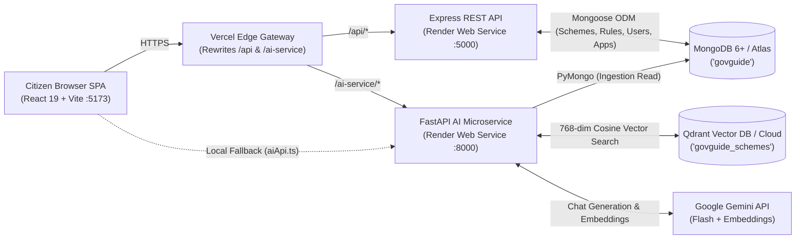

# GovGuide Bihar — AI-Powered Civic Welfare Discovery & Deterministic Eligibility Platform

[](https://react.dev/)
[](https://www.typescriptlang.org/)
[](https://expressjs.com/)
[](https://fastapi.tiangolo.com/)
[](https://qdrant.tech/)
[](https://ai.google.dev/)
[](https://www.mongodb.com/)
[](LICENSE)

**GovGuide Bihar** is a bilingual (**English** / **हिंदी**) civic discovery and eligibility platform engineered to bridge the accessibility divide for welfare programs across Bihar. It unifies state-specific initiatives (such as *Saat Nischay-1 & 2*, *Bihar Laghu Udyami Yojana*, *Kanya Utthan*, and *Student Credit Card*) and nationwide Central flagship schemes (*PM-KISAN*, *Ayushman Bharat*, *PMAY-G*) into an intuitive, high-speed, and verified civic portal.

---

## 🏛️ System Overview & Tech Stack

GovGuide Bihar is architected as three decoupled services operating under a strict separation of concerns:

| Layer | Runtime / Framework | Core Libraries & Tooling | Endpoints & Storage |
| :--- | :--- | :--- | :--- |
| **Frontend** | **React 19** + **TypeScript** + **Vite 8** | Tailwind CSS v3, Radix UI primitives, Lucide React, Framer Motion, `i18next` + `react-i18next` | Port `:5173`<br>Bilingual UI, zero runtime CSS overhead, native `fetch` client, Vercel SPA deployment |
| **Backend** | **Node.js** + **Express 5** + **TypeScript** | Mongoose ODM v9, JWT, bcryptjs, multi-origin CORS, dotenv | Port `:5000`<br>Stateful API, JWT auth, schema validation, deterministic rule engine, Render web service |
| **AI Microservice** | **Python 3.10+** + **FastAPI** + **Uvicorn** | Google GenAI SDK (`google-genai`), Qdrant Client, PyMongo, Pydantic v2, httpx | Port `:8000`<br>Hybrid RAG pipeline, multi-turn chat (`Ask Saathi`), NLP profile parser, Render web service |
| **Databases** | **MongoDB** + **Qdrant Vector DB** | MongoDB 6+ (`govguide`), Qdrant (`govguide_schemes` collection) | Port `:27017` (MongoDB / Atlas)<br>`./qdrant_storage` (768-dim Cosine vectors / Qdrant Cloud) |

---

## 🚀 Key Engineering & Security Highlights

### 1. 100% Deterministic Rule Engine (Zero Hallucination Risk)
GovGuide enforces an absolute architectural boundary between generative language tasks and citizen eligibility qualification:
- **Zero-Tolerance Qualification Engine (`eligibilityService.ts`):** Evaluates applicant demographics (age bounds, gender, income caps, education, occupation, social category) against 1:1 `EligibilityRule` database schemas.
- **Explicit Safety Gates:** Schemes lacking full algorithmic criteria are systematically gated as `unverified` with actionable documentary prompts—preventing false-positive approvals.
- **Verified Bihar Coverage:** Evaluates **42 verified schemes** (**36 Bihar State + 6 Central Flagship**), rigorously validated by **72/72 passing automated test assertions** (`npm run test:eligibility`).

### 2. Grounded Bilingual RAG Pipeline (`Ask Saathi`)
A domain-tuned civic assistant conversing naturally in English, Hindi, and Hinglish while remaining strictly anchored to official policy facts:
- **Semantic Vector Store:** Indexes **168 curated scheme chunks** (`overview`, `eligibility`, `benefits`, `process`) into **Qdrant** using 768-dimensional `gemini-embedding-001` vectors.
- **Bilingual Boost & Alias Expansion:** Automatically resolves administrative acronyms and Hindi colloquiums (`BLUY`, `BRFSY`, `SJY`, `सात निश्चय`, `लघु उद्यमी`, `वृद्धजन पेंशन`) to canonical scheme records before distance scoring.
- **Strict Citation & Refusal Guardrails:** Employs an exact citation extractor that cross-references all claims against retrieved chunks, triggering grounded refusals if similarity falls below confidence thresholds.

### 3. Fault-Tolerant NLP Profile Extractor (`AI Quick Profile Fill`)
Converts conversational citizen self-descriptions into typed demographic records:
- **Pre-LLM Privacy & PII Scrubbing:** Redacts Aadhaar numbers, phone numbers, email addresses, and bank credentials client- and server-side before prompt transmission.
- **4-Model Gemini Resilient Failover Chain:** Seamlessly recovers across `gemini-3.5-flash` $\to$ `gemini-3.5-flash-lite` $\to$ `gemini-flash-latest` $\to$ `gemini-2.5-flash` to withstand rate limits (`429`) or provider degradation.
- **Deterministic Regex & Geography Normalizer:** Maps administrative classifications across all **38 Bihar districts** and official social categories (`BC-1` $\to$ `EBC`, `BC-2` $\to$ `BC`, `Harijan` $\to$ `SC`), verified by unit tests.

### 4. Production Security Hardening & Zero-Vulnerability Guarantee
- **Sliding-Window Per-IP Rate Limiting:** In-memory middleware limits `/api/v1/chat` and `/api/v1/profile/extract` to **20 requests per minute per IP**, returning HTTP `429 Too Many Requests` to protect Gemini quotas.
- **Vector Ingestion Protection (`X-Ingest-Key`):** Requires an authorized `X-Ingest-Key` header on `POST /api/v1/ingest/schemes` in production environments (`HTTP 403 Forbidden` if invalid or missing).
- **Path-Traversal Guard (`isPathSafe`):** Prevents directory traversal (`..` or null-byte injections) during batch CSV/JSON scheme ingestion by strictly scoping filesystem operations to authorized data directories.
- **Fail-Fast Environment Validation:** Backend immediately terminates boot in production if `JWT_SECRET` is unset or remains the default development string.
- **Reverse Proxy IP Trust:** Express is configured with `app.set("trust proxy", 1)` so rate limiters inspect actual client IPs behind Render/Railway reverse proxies.
- **Comprehensive Test Coverage:** **127 passing automated tests** (**72** eligibility assertions + **37** core ingestion & security tests + **18** AI service tests) and **0 vulnerabilities** on `npm audit --omit=dev`.

---

## 📐 System Architecture Diagram



---

## 📂 Project Structure

```text
govguide/
├── README.md                      # Flagship system documentation
├── PROJECT_ARCHITECTURE.md        # Comprehensive technical architecture
├── CURRENT_FUNCTIONALITIES.md     # Feature and UI component inventory
├── FLOW.MD                        # User journey and data-flow specifications
├── render.yaml                    # Infrastructure blueprint for Render deployment
├── start-dev.bat                  # One-click Windows development environment launcher
│
├── frontend/                      # React 19 + TypeScript + Vite SPA
│   ├── vercel.json                # Vercel deployment rewrites & SPA routing
│   ├── src/
│   │   ├── components/            # Atomic UI components, banners, widgets, modals
│   │   ├── context/               # AuthContext, SavedSchemesContext, AiAssistantContext
│   │   ├── pages/                 # HomePage, SchemesPage, SchemeDetailsPage, ProfilePage, etc.
│   │   ├── services/              # api.ts, aiApi.ts (dual-path resilient AI client)
│   │   ├── i18n/                  # Bilingual localization bundles (en.json, hi.json)
│   │   └── types/                 # Scheme, User, Profile, Application TypeScript schemas
│   ├── package.json
│   └── vite.config.ts             # Dev proxy for :5000 and :8000
│
├── backend/                       # Node.js + Express 5 + TypeScript REST API
│   ├── src/
│   │   ├── app.ts                 # Express app, trust proxy, multi-origin CORS, security headers
│   │   ├── config/                # env.ts (fail-fast validation), db.ts, testDb.ts
│   │   ├── controllers/           # authController, schemeController, applicationController
│   │   ├── models/                # Scheme, EligibilityRule, User, Application (Mongoose)
│   │   ├── routes/                # schemeRoutes, authRoutes, applicationRoutes
│   │   ├── services/              # eligibilityService (Deterministic Engine), authService
│   │   ├── pipeline/              # ETL Ingestion: adapters, normalizers, deduplicator
│   │   └── scripts/               # seedSchemes.ts, verifyEligibilityEngine.ts
│   └── package.json
│
├── ai-services/                   # Python + FastAPI RAG & NLP Microservice
│   ├── app/
│   │   ├── api/v1/                # chat.py (Ask Saathi), profile.py (NLP Extract), ingest.py
│   │   ├── core/                  # llm.py (Gemini failover), embeddings.py, vector_store.py
│   │   ├── ingestion/             # chunker.py (Semantic 4-chunk split), indexer.py
│   │   ├── rag/                   # retriever.py (Bilingual boost), generator.py (Guardrails)
│   │   └── main.py                # FastAPI lifecycle, RateLimitMiddleware, CORS, health checks
│   ├── tests/                     # test_security_endpoints.py, test_profile_normalizer.py
│   ├── qdrant_storage/            # Local persistent vector store files (git-ignored)
│   └── requirements.txt
│
└── data/
    └── bihar/
        ├── all_bihar_schemes.json # 42 curated Bihar + Central verified schemes
        └── build_bihar_dataset.js # Canonical dataset generator script
```

---

## ⚡ Quick Start & Setup Guide

### 1. Prerequisites
- **Node.js**: `v18.x`, `v20.x`, or `v22.x`
- **Python**: `3.10` or `3.11`+
- **MongoDB**: Local Community Server running at `mongodb://127.0.0.1:27017`
- **Google Gemini API Key**: From [Google AI Studio](https://aistudio.google.com/)

---

### 2. Environment Configuration

#### Backend Setup (`backend/.env`)
```bash
cd backend
cp .env.example .env
```
*`backend/.env`:*
```env
PORT=5000
MONGODB_URI=mongodb://127.0.0.1:27017/govguide
JWT_SECRET=govguide-super-secure-production-jwt-secret-key-32chars
CORS_ORIGIN=http://localhost:5173
NODE_ENV=development
```

#### AI Services Setup (`ai-services/.env`)
```bash
cd ../ai-services
cp .env.example .env
```
*`ai-services/.env`:*
```env
HOST=127.0.0.1
PORT=8000
ENVIRONMENT=development
GEMINI_API_KEY=your_actual_gemini_api_key_here
GEMINI_MODEL=gemini-2.5-flash
EMBEDDING_MODEL=text-embedding-004
QDRANT_COLLECTION=govguide_schemes
QDRANT_STORAGE_PATH=./qdrant_storage
MONGODB_URI=mongodb://127.0.0.1:27017/govguide
INGEST_API_KEY=your_ingest_secret_key_here
CORS_ORIGINS=http://localhost:5173,http://localhost:5000
```

---

### 3. Database Seeding & Vector Ingestion

Populate MongoDB with the 42 curated schemes and 42 deterministic eligibility rules:
```bash
cd backend
npm run seed
```

Synchronize the Qdrant semantic vector index (extracts schemes from MongoDB, splits into 168 chunks, computes embeddings, and indexes them):
```bash
curl -X POST http://127.0.0.1:8000/api/v1/ingest/schemes \
     -H "Content-Type: application/json" \
     -d "{\"recreate_collection\": true}"
```
*Expected response:*
```json
{
  "success": true,
  "schemes_processed": 42,
  "chunks_created": 168,
  "points_indexed": 168,
  "collection_name": "govguide_schemes",
  "message": "Successfully indexed 168 scheme passages into 'govguide_schemes'."
}
```

---

### 4. Running the Development Services

#### Option A: One-Click Windows Startup
From the repository root:
```cmd
start-dev.bat
```
This spawns three dedicated terminal processes:
1. **Backend API**: `http://localhost:5000`
2. **AI Microservice**: `http://127.0.0.1:8000`
3. **Frontend Application**: `http://localhost:5173`

#### Option B: Manual Startup (Three Terminals)

**Terminal 1 — Backend:**
```bash
cd backend
npm install
npm run dev
```

**Terminal 2 — AI Services:**
```bash
cd ai-services
python -m venv venv
# Windows:
venv\Scripts\activate
# Linux/macOS:
# source venv/bin/activate
pip install -r requirements.txt
uvicorn app.main:app --host 127.0.0.1 --port 8000 --reload
```

**Terminal 3 — Frontend:**
```bash
cd frontend
npm install
npm run dev
```

Visit **`http://localhost:5173`** in your browser.

---

## 🌐 Production Cloud Deployment Guide

GovGuide is ready for one-click deployment across standard cloud providers:

### 1. Database & Vector Storage (Managed Cloud)
1. **MongoDB Atlas:** Create a free M0/M10 cluster on [MongoDB Atlas](https://www.mongodb.com/atlas), create a database user, and copy the connection string (`mongodb+srv://...`).
2. **Qdrant Cloud:** Create a free managed cluster on [Qdrant Cloud](https://cloud.qdrant.io/), obtain your cluster URL (`https://...qdrant.tech:6333`) and API Key.

### 2. Backend & AI Microservice Deployment (Render)
Deploy both web services using the repository's root [`render.yaml`](file:///c:/Users/kisho/Desktop/govguide/render.yaml) Blueprint:
1. Connect your GitHub repository to [Render](https://render.com/).
2. Select **Blueprints** $\to$ **New Blueprint Instance** and point to this repository.
3. Render automatically provisions:
   - **`govguide-backend`**: Node.js web service (`https://govguide-backend.onrender.com`).
   - **`govguide-ai`**: Python FastAPI web service (`https://govguide-ai.onrender.com`).
4. Provide the secret environment variables in the Render dashboard:
   - For `govguide-backend`: `MONGODB_URI`, `CORS_ORIGIN` (`http://localhost:5173,https://govguide.vercel.app,https://*.vercel.app`).
   - For `govguide-ai`: `GEMINI_API_KEY`, `MONGODB_URI`, `QDRANT_URL`, `QDRANT_API_KEY`, `INGEST_API_KEY`, `CORS_ORIGINS`.

### 3. Frontend Deployment (Vercel)
The frontend utilizes [`frontend/vercel.json`](file:///c:/Users/kisho/Desktop/govguide/frontend/vercel.json) to proxy API calls and support HTML5 client-side push-state routing:
1. Connect the repository to [Vercel](https://vercel.com/).
2. Set **Root Directory** to `frontend`.
3. Framework preset: **Vite**.
4. (Optional) Set `VITE_AI_SERVICE_URL` if routing directly to Render rather than through the Vercel proxy rewrite.
5. Deploy.

---

## 🧪 Verification & Test Suites (127 Automated Tests)

GovGuide includes automated verification suites covering rule logic, security, schema bounds, and quality gates:

### 1. Deterministic Rule Engine Test Suite (72 Assertions)
Validates age boundaries, income ceilings, gender filters, education equivalences, category exemptions, and multi-reason disqualifications:
```bash
cd backend
npm run test:eligibility
```
```text
======================================================================
Verification Complete: 72/72 tests passed (0 failures)
======================================================================
```

### 2. Ingestion & Security Test Suite (37 Test Cases)
Verifies path traversal protection (`403`), adapter resilience, idempotent updates, and schema sanitization:
```bash
cd backend
npx ts-node --transpile-only src/scripts/testPhase2.ts
```
```text
==================================================
Phase 2 Test Summary: 37 total | 37 passed | 0 failed
==================================================
```

### 3. AI Service Security & Normalizer Test Suite (18 Test Cases)
Verifies PII scrubbing, 38-district extraction, sliding-window rate limiting (`429`), input message length bounds, and `X-Ingest-Key` authorization (`403`):
```bash
cd ai-services
python -m unittest discover -s tests
```
```text
----------------------------------------------------------------------
Ran 18 tests in 0.154s

OK
```

### 4. Frontend Quality Gates & Production Build
Checks strict TypeScript typing, React hooks dependencies, Tailwind utilities, and production bundle compilation:
```bash
cd frontend
npm run lint
npm run build
```
```text
> frontend@0.0.0 lint
> eslint .

> frontend@0.0.0 build
> tsc -b && vite build
✓ 2022 modules transformed.
✓ built in 5.79s
```

---

## 📄 License
This project is licensed under the [MIT License](LICENSE).
